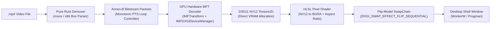

# ArcPaper

<p align="center">
  <strong>Ultra-lightweight, zero-copy hardware-accelerated Windows live wallpaper engine built with pure Rust and Direct3D 11.</strong>
</p>

<p align="center">
  <a href="https://github.com/ArtixForLiving/ArcPaper/releases"></a>
  <a href="https://www.rust-lang.org/"></a>
  <a href="https://www.microsoft.com/windows"></a>
  <a href="LICENSE"></a>
  
</p>

---

## ⚡ Overview

**ArcPaper** is a high-performance, standalone Windows live wallpaper engine engineered in **100% pure Rust**. Unlike traditional wallpaper engines that depend on heavy third-party media players, Electron runtimes, or hundreds of megabytes of bundled C-libraries, ArcPaper features a custom **native Direct3D 11 & Windows Media Foundation hardware video pipeline**.

ArcPaper renders video frames directly into GPU VRAM using high-performance flip-model swapchains (`DXGI_SWAP_EFFECT_FLIP_SEQUENTIAL`) and pins itself securely behind desktop icons (`WorkerW` / `Progman`). With built-in `HTTRANSPARENT` mouse pass-through, desktop icons, file selections, and shortcuts remain 100% responsive with zero input latency.

---

## 📊 Performance Benchmarks

| Metric | ArcPaper v1.5.5 | Traditional Wallpaper Engines |
|---|---|---|
| **Idle / Auto-Pause RAM** | **~4–5 MB** | 80–150 MB |
| **Active 1080p 60 FPS RAM** | **~30–35 MB** | 180–350 MB |
| **CPU Usage (Active)** | **~0.3% – 0.5%** | 3.0% – 12.0% |
| **Auto-Pause CPU Usage** | **0.0%** (Full thread hibernation) | 0.5% – 2.0% |
| **Binary Distribution** | **~1.7 MB standalone executable (Portable ZIP bundle)** | 50–200 MB (Requires DLLs / runtimes) |
| **External Dependencies** | **None (Zero third-party DLLs)** | Requires `libmpv`, `ffmpeg`, or Chromium |

---

## ✨ Features

- **🚀 True Zero-Copy D3D11 Hardware Pipeline**
  - Bitstreams are parsed by a lightweight pure-Rust MP4 demuxer and fed directly into the GPU via Windows Media Foundation Transform (`IMFTransform`).
  - Decoded NV12 surfaces remain entirely inside GPU memory and are mapped directly into a custom HLSL pixel shader for color conversion and aspect-ratio scaling.

- **🖱️ Native Desktop Interaction & Mouse Pass-Through**
  - Child rendering surface intercepts `WM_NCHITTEST` and returns `HTTRANSPARENT` (`-1`).
  - Desktop icons, marquee selections, double-clicks, and context menus pass straight through to `SHELLDLL_DefView` without focus stealing or loading cursor stalls.

- **🎮 Smart Auto-Pause for Gaming & Productivity**
  - Background monitor automatically detects fullscreen games or maximized windows.
  - Instantly hibernates playback on a synchronization `Condvar`, invokes `IDXGIDevice3::Trim` to release GPU driver caches, and trims the process working set (0% CPU, < 8 MB RAM).
  - Resumes instantly and seamlessly when returning to the desktop.

- **🔄 Infinite Seamless Monotonic Looping**
  - In-memory frame index table calculates presentation timestamps (PTS) monotonically forward across loop cycles.
  - Zero timeline seeking, zero audio pops, and zero black-frame stutter during continuous playback loops.

- **💎 Per-Monitor High-DPI Crystal Clear Rendering**
  - Full Per-Monitor V2 DPI awareness ensures crisp physical pixel mapping across 1080p, 1440p, 4K, and ultrawide displays.

- **🔇 Silent Windows Subsystem Execution**
  - Native `#![windows_subsystem = "windows"]` configuration ensures no terminal or console window flashes during launch or startup.

- **🖱️ System Tray Control Center**
  - Non-blocking notification area tray menu with instant controls:
    - **Upload New Wallpaper...** (native Win32 file picker)
    - **Select Active Wallpaper** (switch wallpapers on-the-fly with live indicators)
    - **Pause / Resume Wallpaper**
    - **Playback Speed** (0.5x, 1.0x, 1.5x)
    - **Screen Fit Mode** (Cover, Fill, Contain)
    - **Brightness Control** (100%, 75%, 50%)
    - **Target FPS Profiles** (Unlimited, 60 FPS, 30 FPS, 20 FPS, 15 FPS)
    - **Start with Windows** (clean registry persistence via `HKCU\Software\Microsoft\Windows\CurrentVersion\Run`)
    - **Check for Updates...** (non-blocking GitHub release notifier)
    - **Uninstall ArcPaper** (cleanly deregisters registry entries and cleans up)

---

## 🛠️ Architecture & Tech Stack



| Component | Technology | Description |
|---|---|---|
| **Language** | [Rust](https://www.rust-lang.org/) (2024 edition) | Memory-safe, high-performance systems language |
| **Video Decoding** | Windows Media Foundation (`IMFTransform`) | Hardware video decoding (H.264 / HEVC) via GPU chip |
| **Graphics & Presentation** | Direct3D 11 & DXGI | Flip-model swapchain presenting directly onto desktop surfaces |
| **Desktop Integration** | Win32 API (`windows` crate) | Direct attachment to `WorkerW` / `Progman` with `HTTRANSPARENT` |
| **System Tray UI** | [tray-icon](https://crates.io/crates/tray-icon) & [muda](https://crates.io/crates/muda) | Native, responsive notification tray interface |
| **Configuration** | [serde](https://crates.io/crates/serde) & `serde_json` | Lightweight JSON settings stored locally |

---

## 📥 Installation & Usage

### Portable Distribution Archive (Recommended)

1. Download the latest release package: [`ArcPaper-v1.5.5-win64.zip`](https://github.com/ArtixForLiving/ArcPaper/releases/latest).
2. Extract the ZIP archive to your preferred directory (e.g., `C:\Tools\ArcPaper` or `D:\ArcPaper`).
3. Run `arc_paper.exe`.
4. Right-click the **ArcPaper** icon in your Windows System Tray:
   - Click **"Upload New Wallpaper..."** to select any `.mp4` video.
   - Or choose from the preloaded sample wallpapers in the `SavedWallpapers` folder.
   - Check **"Start with Windows"** if you want ArcPaper to launch automatically on login.

> **Tip:** You can drop any additional `.mp4` video files directly into the `SavedWallpapers` folder next to `arc_paper.exe` to access them instantly from the tray menu!

---

## 🏗️ Building from Source

### Prerequisites
- [Rust toolchain](https://rustup.rs/) (edition 2024 / Rust 1.85+)
- Windows 10 or 11 (64-bit)
- No external C-libraries, runtimes, or DLL downloads required!

### Compilation
```powershell
# Clone the repository
git clone https://github.com/ArtixForLiving/ArcPaper.git
cd ArcPaper

# Compile the optimized release binary
cargo build --release

# Run the test suite (16 tests verifying demuxer, loop controller, decoder, shaders)
cargo test
```

The compiled standalone executable will be located at:
`target/release/arc_paper.exe` (~1.7 MB).

---

## 📄 License

This project is licensed under the [MIT License](LICENSE.md).
