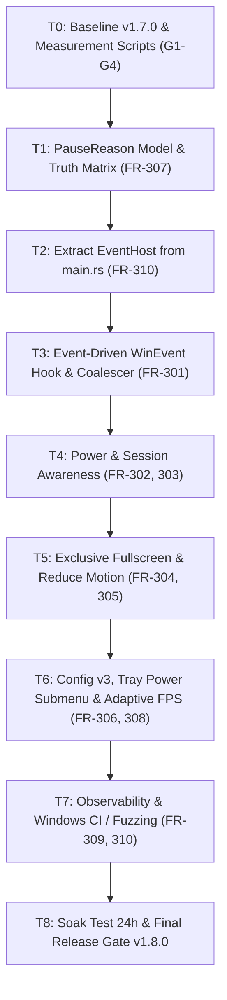

# ArcPaper v1.8.0 (Fase 3: Power-Aware & Efisiensi) Implementation Plan

> **For agentic workers:** REQUIRED SUB-SKILL: Use `superpowers:subagent-driven-development` (recommended) or `superpowers:executing-plans` to implement this plan task-by-task. Steps use checkbox (`- [ ]`) syntax for tracking.

**Goal:** Transform ArcPaper from a polling-based engine into an event-driven, power-and-session-aware live wallpaper engine (latency ≤ 150 ms, idle CPU 0.0%, automatic pause on battery saver / lock / RDP / sleep / exclusive fullscreen, unified `PauseReason` bitflags, `main.rs` < 400 lines, and config schema v3).

**Architecture:** Event-driven architecture utilizing Win32 `SetWinEventHook` (`WINEVENT_OUTOFCONTEXT`) with a 40 ms settle coalescer for window changes, `RegisterPowerSettingNotification` + `WTSRegisterSessionNotification` on a dedicated `ArcPaperEventHost` window for power/session states, unified under a mockable `SystemProbe` trait and a bitflags-based `PauseReason` resolver separating per-monitor and global pause causes.

**Tech Stack:** Rust (edition 2024), `windows` crate (Direct3D 11, DXGI, Win32 UI & System APIs), `bitflags` crate, `serde`/`serde_json`, `tao`, `tray-icon`.

**Spec:** `c:\Users\Artix\Downloads\PRD-ARC-2026-003-v1.8.0.md` (PRD-ARC-2026-003).

---

## Global Constraints
- **Platform:** Windows 10 / 11 x64, GUI subsystem (`windows_subsystem = "windows"`), 0 external DLLs.
- **Binary Size Budget:** Target ≤ 2.0 MiB, hard cap 2.5 MB (2,621,440 bytes).
- **CPU & Latency:** Monitor thread CPU 0.0% when idle (no wakeup timers); auto-pause latency p95 ≤ 150 ms.
- **Reliability:** Zero panics; no black screens or race conditions on sleep/wake; seamless recovery via `DeviceRecoveryCoordinator`.
- **Backward Compatibility:** Config v2 automatically migrates to v3 without losing user settings; fallback to 1000 ms polling if `SetWinEventHook` fails.

---

## Review Focus
1. **`LOCATIONCHANGE` burst flooding:** Window dragging/resizing fires hundreds of events per second; strict filtering (`OBJID_WINDOW`, top-level, non-cloaked) + 40 ms coalescer prevents CPU spikes.
2. **Sleep/Wake vs D3D11 TDR race condition:** Resuming from sleep must coordinate with `DeviceRecoveryCoordinator` to verify D3D11 device health before unpausing.
3. **Desktop without battery:** System with AC-only or UPS (`BatteryFlag = 128 / 255`) must not trigger battery pause or false positive tray status.
4. **Per-monitor isolation:** Fullscreen on Monitor 1 (e.g. game or video) must pause only Monitor 1; Monitor 2 (e.g. spacedesk secondary display) continues rendering.
5. **DWM Cloaked / UWP window regressions:** Re-using verified `is_window_cloaked` and `is_desktop_plane_class` rules guarantees no regression on hotfix `76bdc0d` (Win+D, Settings UWP, Explorer restart).

---

## User Review Required

> [!IMPORTANT]
> **Keputusan Pengguna & Penyesuaian Ruang Lingkup**:
> 1. **Soak Test Disesuaikan:** Durasi soak test diubah dari 24 jam menjadi **1 jam (`soak_1h.ps1`)** demi keamanan dan keterbatasan perangkat keras pengguna. Kriteria kelulusan: RAM stabil ± 5 MB dan tidak ada memory leak / freeze selama 1 jam.
> 2. **Metode Eksekusi:** Menggunakan pendekatan **Subagent-Driven Development (SDD)** (`superpowers:subagent-driven-development`) untuk implementasi setiap task secara modular dan terisolasi.
> 3. **Baseline Measurement Setup with spacedesk**: Setup dual-monitor menggunakan spacedesk pada HP untuk mengukur topologi 2 monitor secara nyata.

> [!NOTE]
> **Rekomendasi Keputusan untuk Open Questions PRD**:
> - **Q1 (Default `battery_policy`)**: `pause_on_battery_saver` (konservatif & ramah pengguna).
> - **Q2 (Status Tray untuk Display Off & Sleep)**: Cukup dicatat di log throttled (tidak perlu di tray tooltip).
> - **Q4 (`treat_presentation_mode_as_busy`)**: Cukup diatur via `config.json` (default `false`).
> - **Q5 (Flag `--force-polling`)**: Ditambahkan untuk mempermudah perbandingan A/B test dan debugging pengguna.

---

## Proposed Changes & Phased Execution



---

### Phase T0: Baseline Measurement & Scripts (Gate G1 – G4)

#### [NEW] `scripts/measure_resource.ps1`
PowerShell script measuring process working set (RAM in MB), thread count, and CPU utilization over a 10-minute window, outputting median and p95 metrics to console and CSV.

#### [NEW] `scripts/measure_pause_latency.ps1`
PowerShell script that automates maximizing and restoring a test window 100 times, reading `--diag-pause` timestamps from ArcPaper log to calculate p95 latency.

#### [NEW] `scripts/soak_1h.ps1`
PowerShell script running ArcPaper for 1 hour, sampling memory and CPU every minute to CSV, verifying stability within ± 5 MB without freeze or crash.

#### [NEW] `docs/baselines/v1.7.0.md`
Documentation of v1.7.0 baseline metrics recorded on single monitor and spacedesk dual monitor (active vs paused).

---

### Phase T1: Unified Pause Model (`PauseReason`) (FR-307)

#### [MODIFY] `Cargo.toml`
Add `bitflags = "2.8"` dependency.

#### [NEW] `src/app/pause.rs`
Define `PauseReason` bitflags:
```rust
use bitflags::bitflags;

bitflags! {
    #[derive(Debug, Clone, Copy, PartialEq, Eq, Default)]
    pub struct PauseReason: u32 {
        const MANUAL               = 1 << 0;
        const COVERED              = 1 << 1;
        const BATTERY              = 1 << 2;
        const BATTERY_SAVER        = 1 << 3;
        const SESSION_LOCKED       = 1 << 4;
        const REMOTE_SESSION       = 1 << 5;
        const DISPLAY_OFF          = 1 << 6;
        const EXCLUSIVE_FULLSCREEN = 1 << 7;
        const REDUCE_MOTION        = 1 << 8;
        const SUSPENDED            = 1 << 9;
    }
}
```
Implement `PauseResolver`:
- Per-monitor reasons: `COVERED | EXCLUSIVE_FULLSCREEN`
- Global reasons: `MANUAL | BATTERY | BATTERY_SAVER | SESSION_LOCKED | REMOTE_SESSION | DISPLAY_OFF | REDUCE_MOTION | SUSPENDED`
- Resolution logic: `is_monitor_paused(id) = !(global | per_monitor[id]).is_empty()`
- Dominant reason string representation for tray tooltip.
- Complete truth matrix unit tests (≥ 10 tests).

#### [MODIFY] `src/app/autopause_monitor.rs`
Update `resolve_effective_pause` to use `PauseReason` while retaining backward-compatible signatures during transition.

---

### Phase T2: Technical Debt Cleanup - Extract Event Host (FR-310)

#### [NEW] `src/app/event_host.rs`
Extract `ArcPaperEventHost`, window class registration, `event_host_wnd_proc`, and user event dispatching out of `src/main.rs`.

#### [MODIFY] `src/main.rs`
Refactor `main.rs` to consume `src/app/event_host.rs`, trimming lines from 934 to **< 400 lines**.

---

### Phase T3: Event-Driven Window Monitor (FR-301)

#### [MODIFY] `Cargo.toml`
Add `Win32_UI_Accessibility` to `windows` features.

#### [NEW] `src/app/winevent.rs`
- Dedicated thread `ArcPaper-WinEventHook` with a Win32 message loop (`GetMessageW`).
- `SetWinEventHook` with `WINEVENT_OUTOFCONTEXT | WINEVENT_SKIPOWNPROCESS`.
- Strict filtering for `EVENT_OBJECT_LOCATIONCHANGE` (`OBJID_WINDOW`, `CHILDID_SELF`, top-level, non-cloaked).
- 40 ms settle coalescer channel triggering `evaluate_monitor_coverage`.
- Single 250 ms re-check timer for slow window animations.
- Safe unhook on exit (`UnhookWinEvent`).
- Fallback to 1000 ms polling if hook installation fails or if `--force-polling` is specified.

---

### Phase T4: Power & Session Awareness (FR-302, FR-303)

#### [MODIFY] `Cargo.toml`
Add `Win32_System_Power` and `Win32_System_RemoteDesktop` to `windows` features.

#### [NEW] `src/power/mod.rs` & `src/power/system_probe.rs`
Trait `SystemProbe` allowing complete mocking of power/session states for CI and unit tests:
```rust
pub trait SystemProbe: Send + Sync {
    fn get_power_status(&self) -> PowerStatus;
    fn is_remote_session(&self) -> bool;
    fn is_reduced_motion_active(&self) -> bool;
}
```

#### [NEW] `src/power/battery.rs` & `src/power/session.rs`
- AC/DC detection, battery percentage, battery saver notifications (`GUID_ACDC_POWER_SOURCE`, `GUID_ENERGY_SAVER_STATUS`).
- WTS session notification (`WTSRegisterSessionNotification`): `WTS_SESSION_LOCK`, `WTS_SESSION_UNLOCK`, `WTS_REMOTE_CONNECT`, `WTS_REMOTE_DISCONNECT`.
- Console display state (`GUID_CONSOLE_DISPLAY_STATE`).
- Suspend & Resume (`PBT_APMSUSPEND`, `PBT_APMRESUMEAUTOMATIC`) with coordination with `DeviceRecoveryCoordinator` before unpausing.

---

### Phase T5: Exclusive Fullscreen & Reduce Motion (FR-304, FR-305)

#### [MODIFY] `Cargo.toml`
Add `Win32_UI_Shell` to `windows` features.

#### [NEW] `src/power/quns.rs`
Query `SHQueryUserNotificationState` (QUNS) without periodic timer—triggered strictly upon foreground window events and mapped to foreground monitor via `MonitorFromWindow`.

#### [NEW] `src/power/motion.rs`
Query `SystemParametersInfo(SPI_GETCLIENTAREAANIMATION)` to respect Windows "Show animations" setting when enabled.

---

### Phase T6: Config Schema v3 & Tray Submenu Power (FR-306, FR-308)

#### [MODIFY] `src/app/config.rs`
- Upgrade to `schema_version = 3`.
- Add `PowerConfig` struct with safe defaults:
```rust
#[derive(Debug, Clone, Serialize, Deserialize, PartialEq)]
pub struct PowerConfig {
    #[serde(default = "default_battery_policy")]
    pub battery_policy: BatteryPolicy,
    #[serde(default = "default_low_battery_threshold")]
    pub low_battery_threshold: u32,
    #[serde(default)]
    pub adaptive_fps: bool,
    #[serde(default = "default_true")]
    pub pause_on_lock: bool,
    #[serde(default = "default_true")]
    pub pause_on_remote: bool,
    #[serde(default = "default_true")]
    pub pause_on_display_off: bool,
    #[serde(default = "default_true")]
    pub detect_exclusive_fullscreen: bool,
    #[serde(default)]
    pub treat_presentation_mode_as_busy: bool,
    #[serde(default)]
    pub follow_reduce_motion: bool,
}
```
- Test migration preserving all v2 fields.

#### [MODIFY] `src/arc_player/autopause.rs`
Add adaptive FPS throttle to 30 FPS with hysteresis (20% / 25%) in `FramePacer`.

#### [MODIFY] `src/app/tray.rs`
Add "Power" submenu with battery policies, toggles for lock/remote/fullscreen/FPS, and dominant pause status in tooltip.

---

### Phase T7: Observability & CI Fuzzing (FR-309, FR-310)

#### [MODIFY] `src/app/log.rs`
Throttled pause transition logging: `[ArcPaper] Pause state changed: Monitor(X) -> PAUSED [Reason: BATTERY_SAVER] (latency: 42ms)`.
Add `--diag-pause` CLI flag support.

#### [MODIFY] `.github/workflows/ci.yml`
Ensure Clippy, format check, unit tests, and fuzz corpus for config v3 run in CI.

---

### Phase T8: Soak Test & Quality Gate

- Execute 1-hour soak test recording RAM stability (± 5 MB) using `scripts/soak_1h.ps1`.
- Verify release binary size ≤ 2.0 MiB (`cargo build --release`).
- Verify ≥ 90 automated tests pass.
- Version bump to `1.8.0` in `Cargo.toml`.

---

## Verification Plan

### Automated Tests
```powershell
# 1. Run all unit and integration tests (target ≥ 90 tests)
cargo test --verbose

# 2. Check Clippy without warnings
cargo clippy --all-targets -- -D warnings

# 3. Check code formatting
cargo fmt --check

# 4. Enforce release binary size budget (<= 2.0 MiB)
cargo build --release
(Get-Item target\release\arc_paper.exe).Length
```

### Manual Verification
1. **Multi-Monitor Coverage (spacedesk)**:
   - Maximize a window on primary monitor: wallpaper on primary pauses within 150 ms; wallpaper on spacedesk phone screen continues playing smoothly.
   - Maximize a window on spacedesk display: spacedesk pauses; primary continues.
   - Minimize/Restore: unpauses automatically within 150 ms.
2. **WinEvent CPU Idle**:
   - Open Task Manager / Perfmon with ArcPaper running idle on desktop.
   - Verify `ArcPaper-WinEventHook` thread consumes 0.0% CPU.
3. **Power & Session (Lock Screen & Sleep)**:
   - Press `Win+L`: ArcPaper transitions to global pause and trims working set memory within 500 ms.
   - Unlock: Wallpapers resume without stutter or crash.
   - Disconnect / Reconnect spacedesk: topology updates cleanly without leaking window surfaces.
4. **Battery Policy**:
   - Toggle Windows Battery Saver: wallpapers pause when `pause_on_battery_saver` is active.
   - Turn Battery Saver off: wallpapers resume.
5. **Config Migration**:
   - Load existing `config.json` from v1.7.0; verify it upgrades to schema v3 without resetting wallpaper paths or fit modes.
